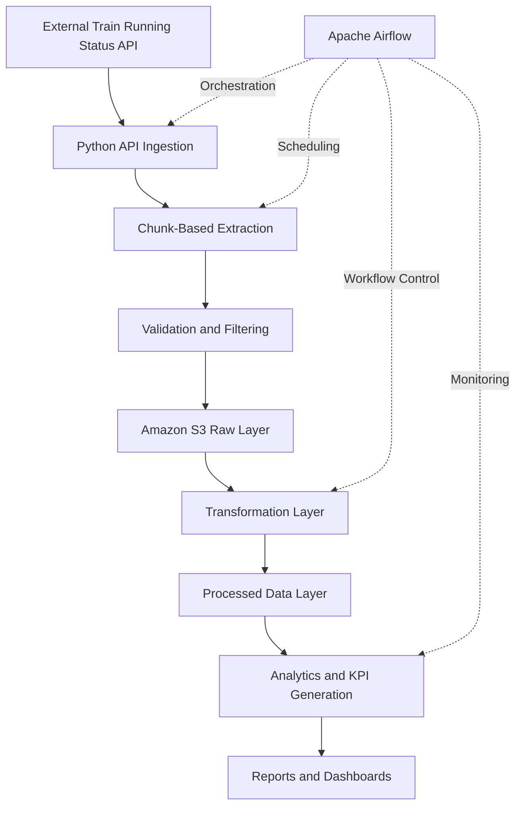

# -Train-Delay-Analytics-Pipeline
# 🚆 Train Delay Analytics Pipeline

### An End-to-End Data Engineering Project for Indian Railways Train Monitoring, Delay Analytics, and Mid-Route Tracking

---

## 📌 Project Overview

The **Train Delay Analytics Pipeline** is a data engineering project designed to collect, process, store, and analyze train-running information for trains operating across India.

The project focuses on identifying trains that are currently running, capturing their live operational status, analyzing delay information, and filtering trains based on their progress along the journey.

The goal is to build a scalable data pipeline capable of handling train-running information in batches, storing raw data for historical analysis, applying transformation and filtering logic, and generating analytical datasets that can be used for reporting and visualization.

The pipeline is designed around a cloud-based data engineering architecture using Python, Apache Airflow, Amazon S3, SQL, and distributed processing technologies.

> **Project status:** Project documentation, presentation, sample reports, and demonstration datasets are available in this repository. Live API integration, production ingestion, and cloud deployment are planned implementation stages and should not be considered operational until validated.

---

## 🎯 Project Objectives

The major objectives of this project are:

- Collect train-running information from an external train status data source.
- Identify trains that are actively running.
- Filter trains based on their journey progress.
- Identify trains that have crossed the midpoint of their route.
- Process data in manageable chunks instead of attempting a single large extraction.
- Store raw API responses in a data lake for traceability.
- Implement incremental ingestion to minimize duplicate records.
- Orchestrate data ingestion and processing using Apache Airflow.
- Transform raw operational data into analytics-ready datasets.
- Generate delay metrics and reporting outputs.
- Design the pipeline for future scalability across the Indian railway network.

---

## 🏗️ Architecture Overview

The pipeline follows a layered data engineering architecture.



### Architecture Components

| Component | Responsibility |
|---|---|
| External API | Provides train-running status information |
| Python | API extraction, validation, processing, and business logic |
| Chunking | Divides extraction work into manageable batches |
| Apache Airflow | Scheduling, orchestration, dependencies, and retries |
| Amazon S3 | Durable cloud storage for raw and processed datasets |
| Transformation Layer | Cleaning, normalization, filtering, and enrichment |
| SQL / Athena | Querying datasets stored in the data lake |
| Analytics Layer | Delay metrics, aggregation, and reporting |
| Power BI / Visualization | Future dashboard and analytical visualization |

---

## 🔄 Data Pipeline Workflow

The pipeline is designed to operate through a sequence of data processing stages.

### 1. Data Ingestion

Train-running information is collected from an external train status API.

The ingestion layer is designed to retrieve relevant information such as:

- Train number
- Train running status
- Journey date
- Train origin
- Train destination
- Current location
- Current speed
- Delay information
- Last updated timestamp
- Next scheduled halt
- Actual arrival and departure information
- Estimated arrival and departure information
- Train journey duration
- Average speed
- Train operating days

The train number is treated as an important identifier for associating records with a train service.

---

### 2. Raw Data Storage

The original API responses are intended to be stored in the raw data layer before applying transformations.

The raw layer preserves source data to support:

- Reprocessing
- Data auditing
- Historical analysis
- Debugging
- Schema changes
- Data quality investigation

Raw records should remain as close as possible to their original source representation.

**Planned raw storage format:**

- JSON
- JSON Lines
- CSV for selected extracts

**Planned cloud storage:**

Amazon S3

Example storage layout:

```text
s3://train-delay-analytics/
│
├── raw/
│   └── train_status/
│       └── ingestion_date=YYYY-MM-DD/
│           └── batch_id=XXXX/
│
├── processed/
│   └── train_status/
│       └── ingestion_date=YYYY-MM-DD/
│
└── analytics/
    └── delay_metrics/
        └── ingestion_date=YYYY-MM-DD/
```

---

### 3. Train Status Filtering

The pipeline is designed to prioritize trains that are actively running.

The filtering logic should exclude trains that do not meet the defined operational criteria.

Initial filtering requirements:

- Train status indicates that the train is running.
- Required train identifiers are present.
- Journey information is available.
- Current position information is sufficiently reliable.
- Records satisfy the journey progress condition.

This reduces unnecessary processing of inactive or irrelevant train records.

---

### 4. Mid-Route Identification

A key feature of this project is identifying trains that have progressed beyond the midpoint of their journey.

Instead of analyzing every train from the beginning of its route, the pipeline focuses on trains that have crossed a calculated midpoint.

The basic midpoint calculation is:

\[
\text{Midpoint Distance} =
\frac{\text{Total Route Distance}}{2}
\]

A train is considered to have crossed the midpoint when:

\[
\text{Current Distance} \geq \text{Midpoint Distance}
\]

The design aims to use route and station information to determine journey progress rather than relying only on a fixed percentage of elapsed journey time.

#### Why Mid-Route Filtering?

- Reduces the volume of records being analyzed.
- Focuses on trains that have progressed significantly through their journeys.
- Helps prioritize operational delay analysis.
- Creates a targeted dataset for downstream analytics.
- Provides a defined filtering condition for data extraction.

Actual midpoint calculation depends on reliable route distance and train position data being available from the selected data source.

---

### 5. Chunk-Based Extraction

The pipeline is designed to process data in chunks.

Instead of requesting or processing the entire dataset in one operation, extraction work can be divided into smaller batches.

```text
Train Dataset
     │
     ▼
Batch / Chunk 1
     │
     ▼
Validate and Process
     │
     ▼
Persist Batch Output
     │
     ▼
Batch / Chunk 2
     │
     ▼
Validate and Process
     │
     ▼
Persist Batch Output
     │
     ▼
Continue Until Completion
```

Chunk-based processing is useful for:

- Managing API request limits.
- Reducing memory consumption.
- Handling large numbers of train identifiers.
- Recovering from failures.
- Improving retry management.
- Supporting incremental execution.

Each chunk should have an execution status so that completed batches do not need to be unnecessarily repeated.

---

## 🔁 Incremental Data Loading

Incremental loading is an important component of the pipeline design.

The system should avoid repeatedly storing identical records while preserving meaningful updates to train-running status.

Potential approaches include:

- Unique record identifiers
- Train number and journey date combinations
- Event timestamps
- Source update timestamps
- Batch identifiers
- Last successful ingestion timestamp
- Record-level comparison
- Deduplication logic

A logical record key may be based on a combination of train number, journey date, and observation timestamp, depending on the source data's structure.

Incremental processing is intended to:

- Reduce redundant data.
- Improve ingestion efficiency.
- Preserve historical changes.
- Avoid duplicate analytical records.
- Support recovery after failed executions.

---

## 🗂️ Data Lake Design

The project follows a layered data lake approach.

### Raw Layer

Stores the source data collected from the API.

Characteristics:

- Original source records
- Minimal transformation
- Historical snapshots
- Auditability
- Source traceability

### Processed Layer

Stores validated and transformed data.

Characteristics:

- Standardized field names
- Cleaned records
- Valid data types
- Deduplicated records
- Mid-route filtered records
- Structured datasets suitable for analytics

### Analytics Layer

Designed to contain aggregated and analytical outputs.

Potential outputs include:

- Average train delay
- Delay distribution
- Train counts by delay category
- Delay patterns by route
- Delay patterns by train category
- Journey progress metrics
- Observation frequency

---

## 📊 Analytics and KPIs

The analytics layer is designed to support train delay analysis through metrics and aggregations.

### Planned KPIs

| KPI | Description |
|---|---|
| Total Observed Trains | Number of train records collected |
| Active Trains | Trains identified as currently running |
| Mid-Route Trains | Trains that satisfy the journey progress filter |
| Average Delay | Mean delay across valid filtered records |
| Maximum Delay | Highest observed delay |
| On-Time / Minor Delay Count | Count of trains within the defined low-delay category |
| Moderate Delay Count | Count of trains in the moderate-delay category |
| Major Delay Count | Count of trains exceeding the major-delay threshold |
| Data Completeness | Percentage of records containing required fields |
| Duplicate Records | Number of duplicate records identified |
| Pipeline Execution Time | Total time taken for pipeline execution |

Delay categories and threshold values must be finalized based on the project's defined analytical rules.

---

## 🧰 Technology Stack

| Technology | Usage |
|---|---|
| Python | Data extraction and transformation |
| REST API | Source data ingestion |
| Apache Airflow | Workflow orchestration |
| Amazon S3 | Cloud data lake storage |
| SQL | Data querying and analysis |
| AWS Athena | Serverless querying of S3 datasets (planned) |
| PySpark | Distributed data processing (planned) |
| Power BI | Dashboarding and visualization (planned) |
| Git & GitHub | Version control and project documentation |

---

## 📁 Repository Contents

The repository currently contains project documentation and demonstration deliverables.

```text
Train-Delay-Analytics-Pipeline/
│
├── README.md
├── Train_Delay_Analytics_Pipeline_Presentation.pptx
├── Train_Delay_Analytics_Sample_Report.pdf
├── analysis_report.md
├── data_dictionary.csv
├── sample_kpis.csv
├── sample_run_summary.json
└── delay_categories.png
```

### File Descriptions

| File | Description |
|---|---|
| `README.md` | Project overview, architecture, and documentation |
| `Train_Delay_Analytics_Pipeline_Presentation.pptx` | Project presentation |
| `Train_Delay_Analytics_Sample_Report.pdf` | Sample analytical report |
| `analysis_report.md` | Detailed analysis documentation |
| `data_dictionary.csv` | Field definitions and metadata |
| `sample_kpis.csv` | Demonstration KPI data |
| `sample_run_summary.json` | Example pipeline execution summary |
| `delay_categories.png` | Delay category visualization |

The currently uploaded datasets and reports are demonstration artifacts and are not verified live railway operational data.

---

## 🧪 Sample Data and Demonstration Results

The sample analytics package demonstrates the reporting workflow using simulated records.

The sample dataset contains:

- 80 total records
- 66 active records
- 66 filtered records
- 31.8 minutes average delay in the demonstration sample

These values are intended to demonstrate data processing and reporting, not actual railway statistics.

The sample data is used to demonstrate:

- Data filtering
- KPI calculation
- Delay classification
- Reporting
- Visualization

Live API results must be collected and validated before using the metrics as operational findings.

---

## 📈 Expected Future Dashboard

The future dashboard may include the following views:

### Train Monitoring

- Total trains monitored
- Currently running trains
- Trains beyond midpoint
- Delay status summary

### Delay Analytics

- Average delay
- Delay category distribution
- Maximum delay
- Delay frequency

### Route Analysis

- Train distribution by route
- Origin and destination analysis
- Route-based delay aggregation

### Pipeline Monitoring

- Successful batches
- Failed batches
- Data ingestion volume
- Pipeline runtime
- API failure count
- Duplicate record count

---

## ⚙️ Orchestration with Apache Airflow

Apache Airflow is planned to manage the data pipeline workflow.

Potential workflow stages:

```text
START
  │
  ▼
Initialize Pipeline
  │
  ▼
Load Configuration
  │
  ▼
Generate / Load Train Batch
  │
  ▼
Extract Train Status
  │
  ▼
Validate API Response
  │
  ▼
Apply Running Filter
  │
  ▼
Apply Mid-Route Filter
  │
  ▼
Save Raw Data
  │
  ▼
Transform and Deduplicate
  │
  ▼
Save Processed Data
  │
  ▼
Generate Analytics
  │
  ▼
Pipeline Summary
  │
  ▼
END
```

### Airflow Responsibilities

- Schedule execution
- Manage task dependencies
- Retry failed tasks
- Monitor execution status
- Track batch completion
- Manage pipeline workflow
- Provide logs for debugging
- Support recovery from failures

---

## ☁️ AWS Integration Plan

Amazon S3 is planned as the primary storage layer for the data lake.

### S3 Responsibilities

- Store raw API data.
- Store processed datasets.
- Maintain historical ingestion snapshots.
- Organize datasets by date and batch.
- Provide storage for downstream analytics.

### Planned AWS Services

| Service | Purpose |
|---|---|
| Amazon S3 | Data lake storage |
| AWS IAM | Access control and permissions |
| Amazon Athena | Query data directly from S3 |
| AWS Glue | Data catalog and metadata management |
| AWS CloudWatch | Monitoring and logging |

The AWS implementation will follow least-privilege access principles and use environment-based configuration for credentials.

---

## 🛡️ Data Quality and Reliability

Data quality checks are essential to ensure reliable analytics.

The pipeline is intended to validate:

- Missing train numbers
- Invalid timestamps
- Missing train status
- Invalid delay values
- Unexpected API response structure
- Duplicate records
- Invalid journey distances
- Missing current positions
- Invalid train-running states

Records failing validation may be rejected, quarantined, or logged depending on the validation rule.

---

## 🚧 Challenges and Considerations

Potential engineering challenges include:

- API rate limits
- API availability
- Inconsistent response schemas
- Missing route-distance information
- Train position accuracy
- Duplicate observations
- Incremental state management
- Large extraction batches
- Retry handling
- Historical data retention
- Cloud storage organization
- Workflow failures

These challenges will be addressed through validation, batch control, retry strategies, logging, incremental ingestion, and modular pipeline design.

---

## 🔮 Future Enhancements

The project roadmap includes:

- [ ] Verify and integrate the live train status API.
- [ ] Implement API authentication and configuration.
- [ ] Build the production ingestion module.
- [ ] Implement chunk-based extraction.
- [ ] Implement running train filtering.
- [ ] Implement route midpoint calculation using station distance data.
- [ ] Implement incremental ingestion and deduplication.
- [ ] Integrate Apache Airflow DAGs.
- [ ] Configure Amazon S3 raw and processed storage.
- [ ] Implement schema validation and data quality checks.
- [ ] Add PySpark transformation jobs.
- [ ] Integrate AWS Glue Data Catalog.
- [ ] Query processed data using Amazon Athena.
- [ ] Create a Power BI analytics dashboard.
- [ ] Add automated testing.
- [ ] Add pipeline logging and monitoring.
- [ ] Improve fault tolerance and recovery.
- [ ] Implement historical trend analysis.

---

## 🎓 Project Learning Outcomes

This project is designed to demonstrate practical data engineering concepts including:

- API-based data ingestion
- Batch processing
- Data lake architecture
- Raw and processed data separation
- Incremental data loading
- Deduplication
- Data transformation
- Data quality validation
- Workflow orchestration
- Cloud storage integration
- Analytics and KPI generation
- Project documentation
- Version control

---

## 👨‍💻 Author

**Jay Prakash Pandey**

Computer Science Graduate | Aspiring Data Engineer

**Technical Interests:** Data Engineering, Cloud Computing, Big Data, ETL Pipelines, Analytics Engineering, AWS

- [LinkedIn](https://linkedin.com/in/jaypandey10)
- [GitHub](https://github.com/prakashjaypandey)

---

## ⚠️ Disclaimer

This is an educational and portfolio project developed for learning and demonstrating data engineering concepts.

Sample reports and demonstration metrics are based on simulated data. They do not represent official Indian Railways operational statistics.

Actual live data availability, API usage permissions, reliability, and field structure must be verified before production use.

---

⭐ If you find this project interesting, feel free to explore the repository and follow its future development.
